# Aggregatarr

Aggregatarr is a self-hosted dashboard for a home media stack. It is one working view of Sonarr, Radarr, Lidarr, Prowlarr, Bazarr, qBittorrent, and SABnzbd: the download queue, the upcoming calendar, recent grabs and imports, and the health warnings those apps already know about.

It is not a tile launcher. The server polls each app, merges the results, and the page updates over the Blazor circuit. API keys and passwords never go to the browser.

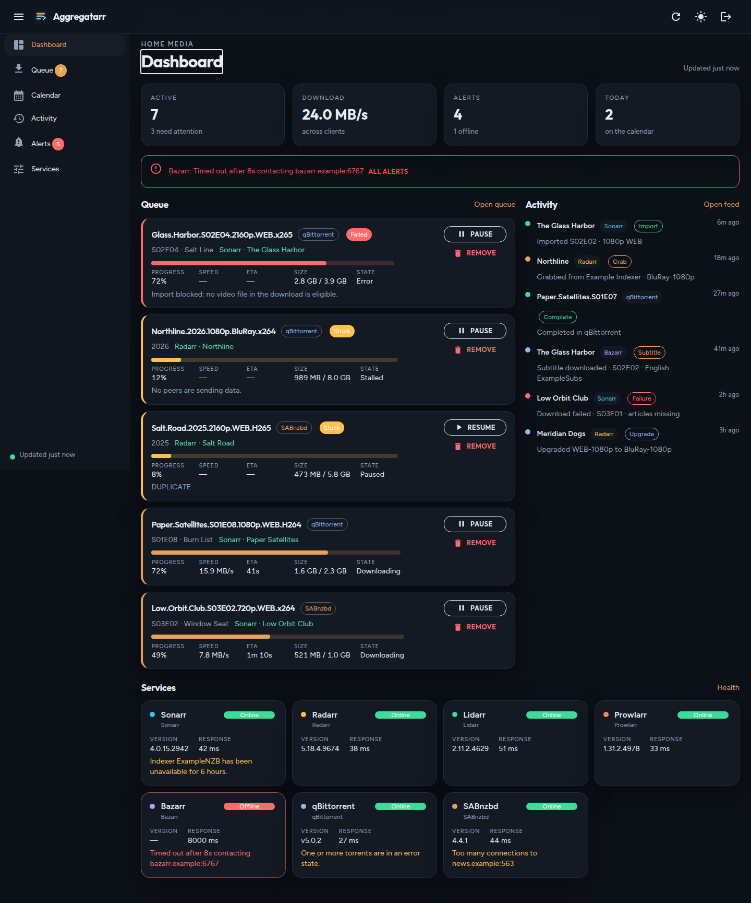

## Screenshots

| Dashboard | Queue |
| --- | --- |
|  | 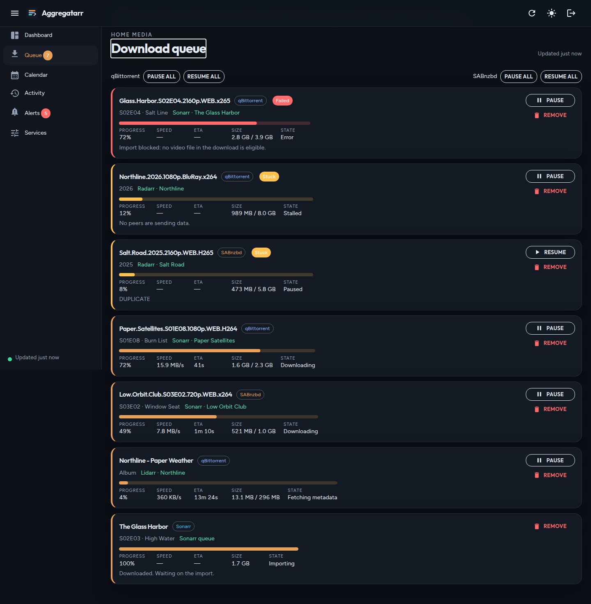 |

| Calendar | Activity |
| --- | --- |
| 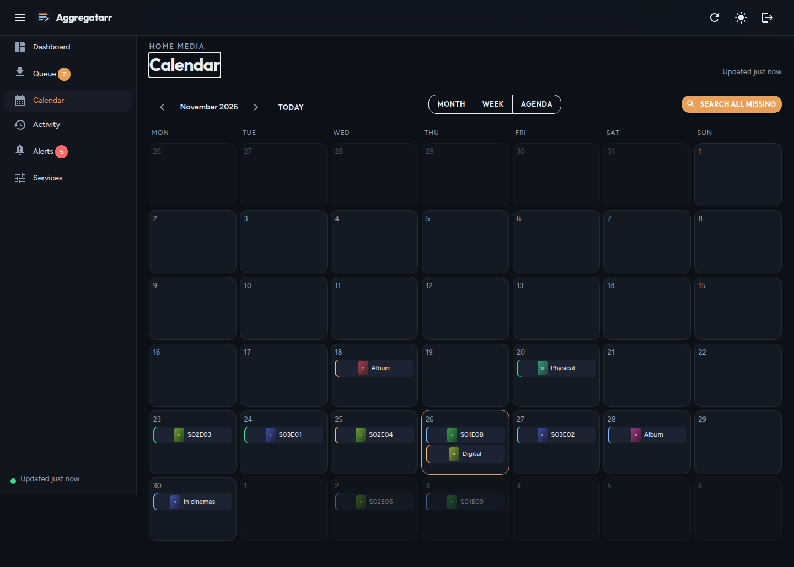 | 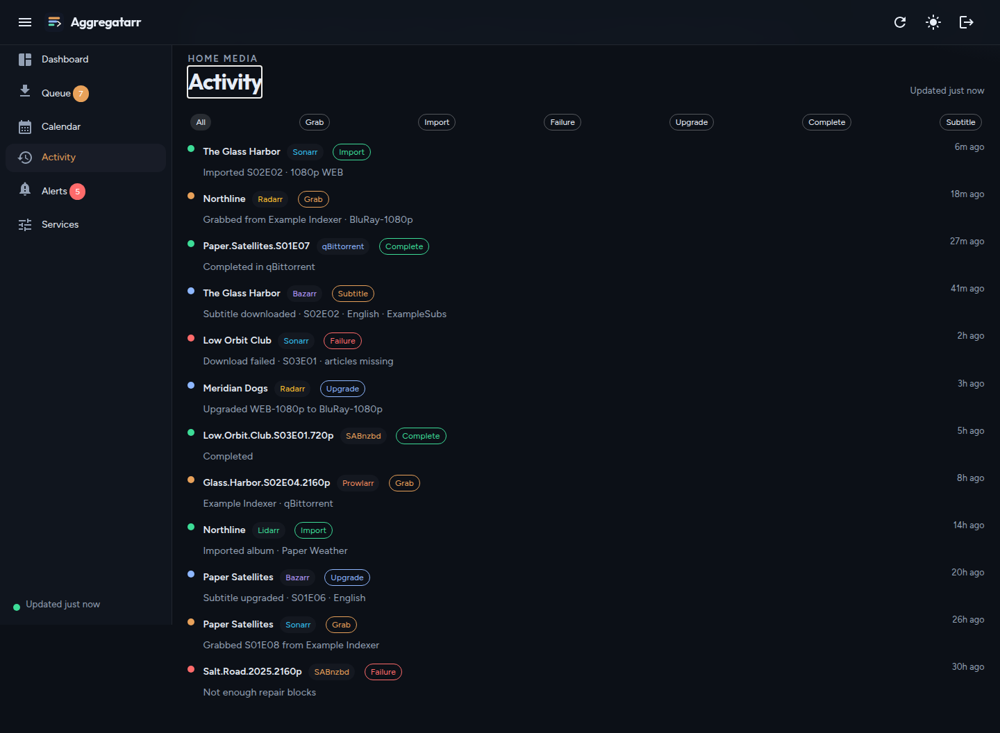 |

| Alerts | Services |
| --- | --- |
| 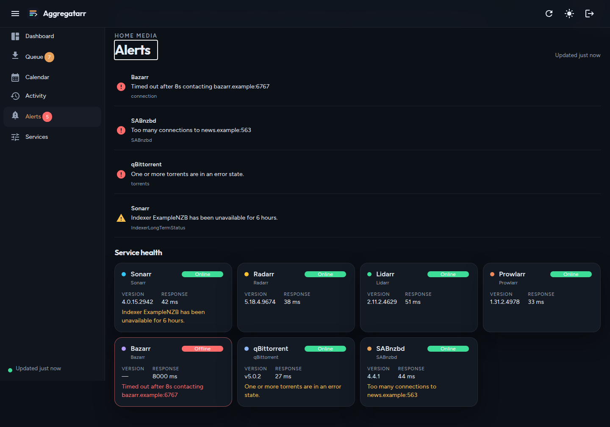 | 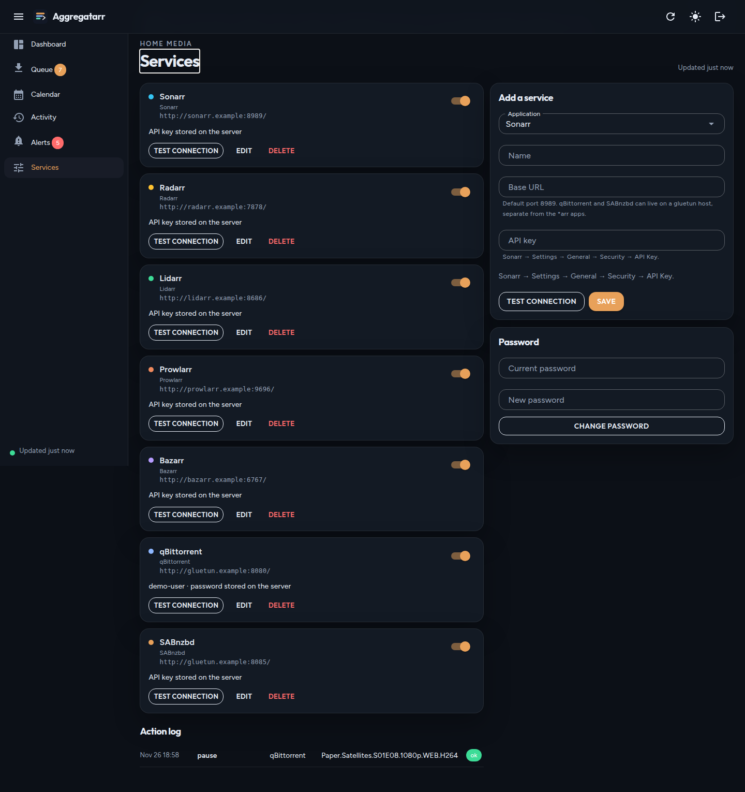 |

Phone width:

| Dashboard | Queue | Settings |
| --- | --- | --- |
| 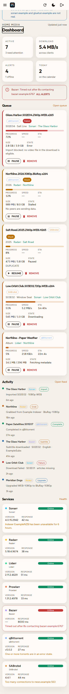 | 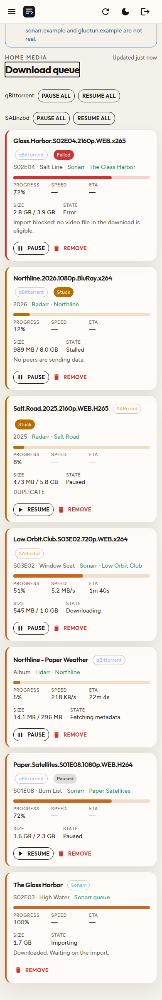 | 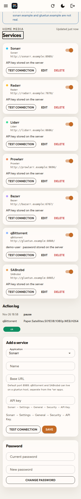 |

Removing a download asks first. Pause and resume do not.

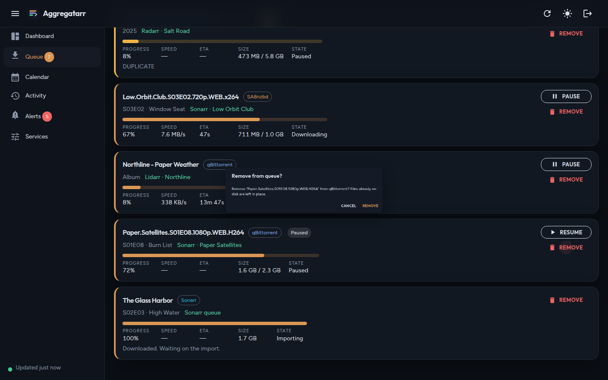

## Themes

The app bar palette menu, and the Theme card on Services, choose **Dark**, **Light**, or **LCARS**. Dark is the default and is unchanged. The choice is stored in the SQLite file under `/config`, so it survives a reload and shows up on another device pointed at the same install.

LCARS is an original layout in the TNG/Voyager style: black field, orange elbow, pill segments, and Antonio (self-hosted, SIL Open Font License, see `src/Aggregatarr.Web/wwwroot/fonts/antonio/OFL.txt`). It does not use Star Trek logos. Health problems switch a frame segment to red, with a pulse that stays still when the browser asks for reduced motion.

| LCARS dashboard | LCARS phone |
| --- | --- |
| 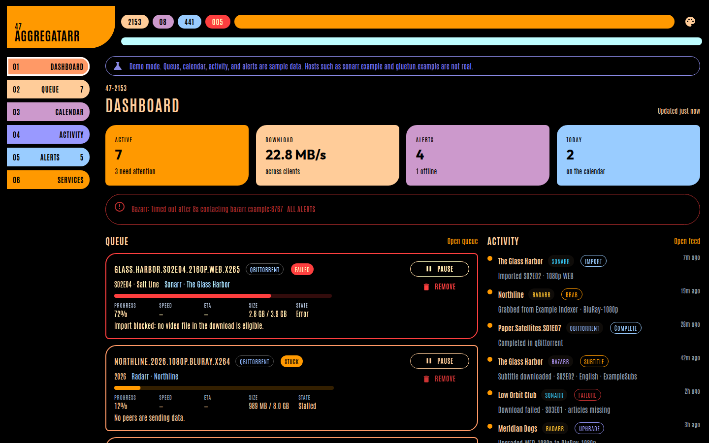 | 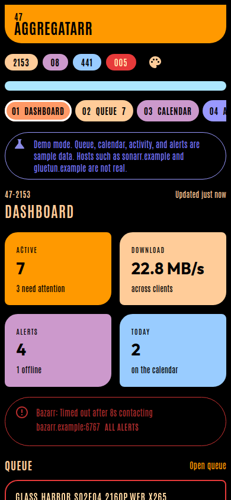 |

| LCARS queue | LCARS calendar |
| --- | --- |
| 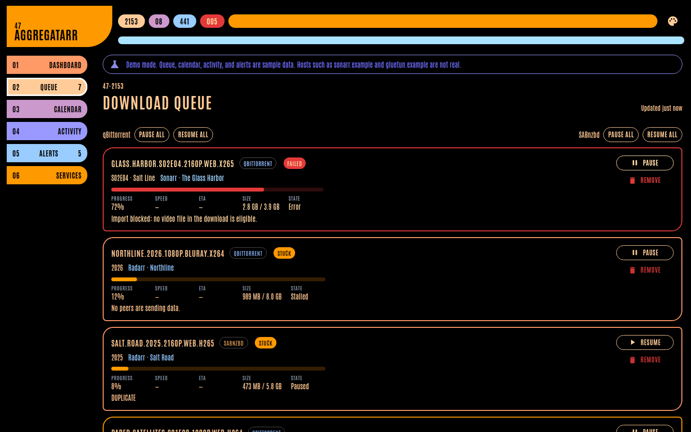 | 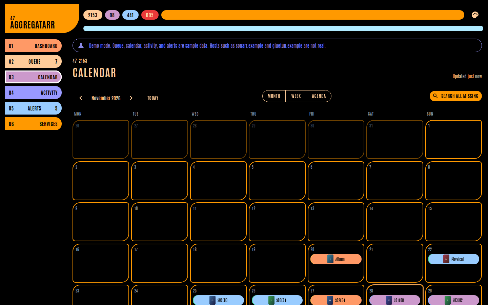 |

## What you can do

- **Queue.** qBittorrent torrents and SABnzbd jobs in one list, matched to the Sonarr episode, Radarr movie, or Lidarr album when the download id lines up. Name, client, progress, speed, ETA, size, and state. Failed and stuck rows stay at the top. Imports that are still sitting in an *arr queue show up even after the client has finished.
- **Calendar.** Upcoming Sonarr episodes, Radarr releases, and Lidarr albums. Month, week, and agenda. Posters come from the app that owns the title. Each entry is upcoming, missing, downloaded, or unmonitored.
- **Activity.** Grabs, imports, failures, upgrades, completed downloads, and Bazarr subtitle events, newest first.
- **Alerts.** Online or offline, version, response time, and the warnings each app reports: Servarr health, Bazarr health, SABnzbd warnings, qBittorrent errors. A dead service becomes a card that says why. It does not take the page down.
- **Actions.** Pause or resume one download, or everything on a client. Search one missing episode, movie, or album, or search all missing. Remove asks for confirmation and leaves files already on disk alone. Every action is written to the log on the Services page.
- **Services.** Add, edit, enable, and test each connection. Test connection checks the app without printing the stored secret back.

## Quick start

### Docker

```bash
docker run -d \
  --name aggregatarr \
  --user 99:100 \
  -p 8080:8080 \
  -v /path/to/config:/config \
  -e TZ=UTC \
  ghcr.io/007darkmatter5/aggregatarr:latest
```

Open `http://<host>:8080`. The first visit is a setup form that creates the only admin account. Passwords are hashed. After that, sign-in is a cookie.

`docker compose up -d` using the [docker-compose.yml](docker-compose.yml) in this repo does the same thing with a `./config` folder.

qBittorrent and SABnzbd that run behind gluetun are just URLs. Point Aggregatarr at the gluetun host and the app's own port. They do not need to share a hostname with Sonarr.

### Unraid

The Community Applications template is [unraid/aggregatarr.xml](unraid/aggregatarr.xml).

- Port `8080`
- `/config` mapped to `/mnt/user/appdata/aggregatarr`
- The image runs as uid `99` and gid `100` (`nobody:users`). The template also passes `--user 99:100`. PUID and PGID are documented on the template for the usual Unraid fields; the process user is fixed in the image.
- WebUI `http://[IP]:[PORT:8080]/`
- Icon, support, and project URLs point at this repository

`TemplateURL` is `https://raw.githubusercontent.com/007darkmatter5/unraid-templates/main/templates/aggregatarr.xml` so the XML can be copied into that templates repo without editing it.

### From source

.NET 10 SDK:

```bash
dotnet run --project src/Aggregatarr.Web
```

That listens on `http://localhost:5088` and stores data in `./config`. `ASPNETCORE_ENVIRONMENT=Development` (set by the launch profile) is what serves the MudBlazor files while you are running from source. A published build copies those files into `wwwroot`.

### Try the UI with sample data

```bash
AGGREGATARR_DEMO=true dotnet run --project src/Aggregatarr.Web
```

Demo mode seeds an account `demo` / `demo` and seven fake services (`sonarr.example`, `gluetun.example`, and so on). The queue moves, and pause, resume, remove, and search update the sample and the action log. Nothing is contacted on the network. Do not expose demo mode; the password is public.

## Where to copy each credential

| App | What Aggregatarr needs | Where it is in that app |
| --- | --- | --- |
| Sonarr | URL and API key | Settings → General → Security → API Key. Default port 8989. |
| Radarr | URL and API key | Settings → General → Security → API Key. Default port 7878. |
| Lidarr | URL and API key | Settings → General → Security → API Key. Default port 8686. |
| Prowlarr | URL and API key | Settings → General → Security → API Key. Default port 9696. |
| Bazarr | URL and API key | Settings → General → Security → API Key. Sent as `X-API-KEY`. Default port 6767. |
| qBittorrent | URL, WebUI username, password | Tools → Options → Web UI. Default port 8080. WebAPI 2.11+ (qBittorrent 5) uses stop/start; older 4.x uses pause/resume, and Aggregatarr falls back when stop returns 404. |
| SABnzbd | URL and API key | Settings → General → Security → API Key. Sent as the `X-Api-Key` header, which needs SABnzbd 4 or newer. Default port 8080, or whatever port you published through gluetun. |

The key is not written into the page, the edit form, or a SignalR payload. The form says the key is stored. Leaving the field blank on edit keeps the current value. A replacement is encrypted and the box is cleared.

## Architecture

```text
browser  --cookie-->  Blazor Server (MudBlazor)
                         |  DashboardStore (in memory)
                         |  poller, per service, with its own timeout
                         v
                       connectors  --X-Api-Key / WebUI cookie-->  your apps
                         ^
                       SQLite in /config
                       Data Protection keys in /config/keys
```

**Why SQLite.** The action log, the account, and the service list are updated from the poller and from the page at the same time. A single SQLite file in `/config` handles that with WAL, and it is one file to back up. JSON would have meant a hand-rolled lock around the log. The schema is created on first start (`EnsureCreated`). There is no migration history yet, so a future schema change may mean recreating `/config/aggregatarr.db` and signing in again.

**Polling.** The queue is refreshed every 5 seconds. Calendar, history, and the slower health details are refreshed every 12th pass (about a minute). Each service has its own 8 second timeout. One app that does not answer is marked offline with the reason; the others still render.

**Secrets.** ASP.NET Data Protection encrypts API keys and the qBittorrent password before they are written. The key ring lives in `/config/keys`. The key ring itself is not certificate-wrapped, which is the usual container tradeoff: protect the `/config` volume. SABnzbd's key is a header, not a query string, so request logs cannot record it. Connectors log the path and the service name. A failed response that echoes a key is scrubbed before it is shown or logged.

**Posters.** Relative `MediaCover` paths are fetched by the server with the API key and streamed from `/media/{serviceId}/...`. The browser never sees the key. Demo mode uses generated posters at `/demo/poster/{name}`.

**Auth.** Cookie authentication, HTTP-only, SameSite=Lax, 14 days sliding. `/healthz` is anonymous and returns only `{"status":"ok"}`. Everything else needs the account. The app trusts `X-Forwarded-Proto` so a reverse proxy can terminate TLS. Only do that when the proxy is the thing exposed to the network.

## Adding a connector

Connectors live in `src/Aggregatarr.Core/Connectors` and implement `IMediaConnector`:

1. `TestAsync` hits a cheap status route and returns a version or a cleaned error.
2. `PollAsync` returns queue rows, calendar rows, activity, and warnings. `PollDepth.Fast` can skip calendar and history.
3. `ExecuteAsync` handles the actions that app actually supports and throws `NotSupportedException` for the rest.

Register the class as `IMediaConnector` in `Program.cs`. Add a `ServiceKind` value, a default port, and a credential hint. Put canned JSON from the real API under `tests/Aggregatarr.Tests/Fixtures` and drive the connector with `ScriptedHandler` so the test never opens a socket.

Sonarr, Radarr, and Lidarr share `ServarrConnector` (`api/v3`, `api/v3`, and `api/v1`). Prowlarr, Bazarr, qBittorrent, and SABnzbd each have their own class because the shapes diverge.

## Security

- Meant for a trusted LAN, or a reverse proxy in front of that LAN. There is one shared account.
- Credentials are not rendered and are not part of the models the circuit is allowed to hold. Tests cover the connector logs, the settings JSON, the database column, and the HTML of the signed-in pages.
- Destructive queue removal and deleting a saved service both ask first.
- Logout is a same-site POST. The cookie is SameSite=Lax, so another site cannot ride it.
- Do not commit real hosts, IPs, or keys. The examples in this repo are `*.example`.

## Development

```bash
dotnet test Aggregatarr.sln
```

Tests use xUnit and canned payloads for Sonarr v3, Radarr v3, Lidarr v1, Prowlarr v1, Bazarr, qBittorrent WebUI API v2, and the SABnzbd API. No test contacts a live app.

GitHub Actions runs the tests, builds the image, hits `/healthz`, and pushes `linux/amd64` and `linux/arm64` to `ghcr.io/007darkmatter5/aggregatarr`. `main` is tagged `latest` and `sha-<commit>`. A `v*` git tag also pushes semver tags (`1.2.3`, `1.2`, `1`).

The image is built from the .NET 10 SDK and ASP.NET runtime. The process user is `99:100`.

## Known limits

- Bazarr is health, history, and warnings. Searching wanted subtitles is not wired up.
- qBittorrent's torrent list is requested in full. A very large client will make the fast poll heavier than it needs to be.
- The calendar fetch covers roughly the previous month through two months ahead, and widens when you move outside that.
- One account. No per-user roles.
- Removing a download does not blocklist the release. It removes the client item, or the *arr queue row with `removeFromClient=true` and `blocklist=false`.

## License

MIT. See [LICENSE](LICENSE).
